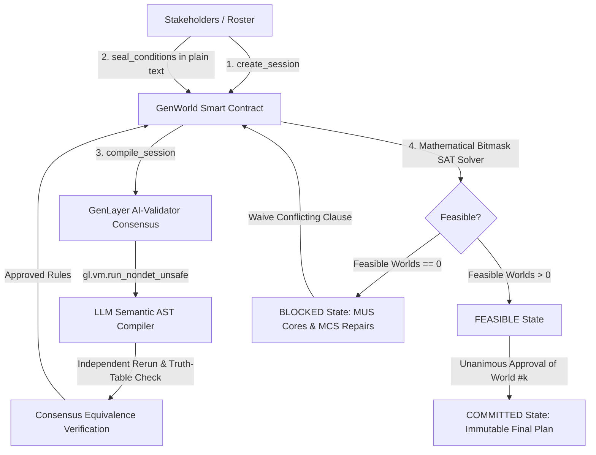

# GenWorld Protocol

**Decentralized Semantic Constraint Negotiation & Multi-Stakeholder Plan Alignment Protocol on GenLayer**

[-00f5d4?style=for-the-badge&logo=ethereum)](https://explorer-studio.genlayer.com/address/0xeEfca6ffd18CCbd3Ee43D4bDFdD5CCbf69A62be8)
[-10b981?style=for-the-badge)](https://explorer-studio.genlayer.com/tx/0xde309afcaf688c182059dc32f9e6829a9b63fa2f800a639fd98319342003f03a)
[](LICENSE)

---

## 1. Verified Live On-Chain Deployment

The canonical **GenWorld** intelligent contract is deployed and actively verified on GenLayer StudioNet:

- **Network:** GenLayer StudioNet (Stable)
- **Chain ID:** `61999`
- **Contract Name:** `GenWorld`
- **Contract Address:** [`0xeEfca6ffd18CCbd3Ee43D4bDFdD5CCbf69A62be8`](https://explorer-studio.genlayer.com/address/0xeEfca6ffd18CCbd3Ee43D4bDFdD5CCbf69A62be8)
- **Deployment Transaction Hash:** [`0xde309afcaf688c182059dc32f9e6829a9b63fa2f800a639fd98319342003f03a`](https://explorer-studio.genlayer.com/tx/0xde309afcaf688c182059dc32f9e6829a9b63fa2f800a639fd98319342003f03a)
- **Flagship Session Creation Tx:** [`0x85ffb69f9deea7705227bd3ef7de40afdce708e3889455df2abfd766ad31db1a`](https://explorer-studio.genlayer.com/tx/0x85ffb69f9deea7705227bd3ef7de40afdce708e3889455df2abfd766ad31db1a)
- **Flagship Condition Seal Tx:** [`0x90c32e564ea051ad57042950f052a0b7f6a9a44859a790fbdf0ec97693c6ed27`](https://explorer-studio.genlayer.com/tx/0x90c32e564ea051ad57042950f052a0b7f6a9a44859a790fbdf0ec97693c6ed27)
- **Detailed Live Proof Log:** [`docs/live-proof.md`](docs/live-proof.md)

---

## 2. Overview & Problem Statement

Multi-party coordination across sovereign organizations, decentralized autonomous organizations (DAOs), or autonomous AI agents faces a fundamental dilemma: **how can independent stakeholders negotiate a mutually agreeable joint configuration without trusting a centralized mediator or revealing compromise thresholds prematurely?**

Traditional smart contracts require deterministic, rigid parameter encoding up-front and cannot interpret human natural language agreements, legal clauses, or subjective requirements. Conversely, off-chain LLMs are subjective, hallucination-prone, and lack consensus-backed state finality.

### The GenWorld Solution

**GenWorld** bridges this divide by providing:
1. **Discrete Possibility Space ("Domain of Worlds"):** Stakeholders define a finite parameter matrix (e.g. power architecture, water buffers, autonomy tier, zoning, or resource quotas) generating up to 64 concrete discrete "worlds".
2. **Natural Language Constraint Submission:** Each participant enters their policy or constraints in plain text (e.g., *"Power source must be nuclear or fusion for baseload radiation shield safety during lunar night"*).
3. **Decentralized AI-Validator Compilation:** GenLayer AI validators independently compile the natural language statements into strict, typed boolean Abstract Syntax Trees (ASTs) over the frozen domain variables.
4. **On-Chain Mathematical Satisfiability & Conflict Diagnosis:** The contract evaluates truth bitmasks across all candidate worlds. If mutually contradictory, the contract automatically isolates **Minimal Unsatisfiable Subsets (MUS cores)** and computes **Minimal Correction Sets (MCS repairs)** with witness worlds.
5. **Interactive Waiver & Unanimous Commitment:** Stakeholders can waive conflicting clauses to restore feasibility. Once a mutually agreeable world configuration is selected, unanimous approval locks the plan permanently on-chain.

---

## 3. Protocol Architecture



---

## 4. How GenWorld Uses GenLayer

### A. GenVM Execution & Pinned Runner Dependency
`contracts/gen_world.py` executes inside GenLayer's GenVM sandbox and is pinned to the verified runner:
```python
# { "Depends": "py-genlayer:1jb45aa8ynh2a9c9xn3b7qqh8sm5q93hwfp7jqmwsfhh8jpz09h6" }
```

### B. Strict Storage Pre-Extraction Compliance
To prevent pickling errors and consensus non-determinism, the contract pre-extracts all storage snapshot state into local Python variables before defining non-deterministic closures:
```python
snapshot_json = _canonical_json(snapshot)
prompt_text = _build_ai_prompt(snapshot)

def leader_fn() -> str:
    raw_response = gl.nondet.exec_prompt(prompt_text, response_format="text")
    ...
```

### C. Differential Consensus & Truth-Table Equivalence
Validation does not merely check JSON formatting. Instead, the validator independently executes the LLM task, parses the AST, and compares the resulting **boolean truth masks across all candidate worlds in the domain**:
```python
def validator_fn(leader_res) -> bool:
    if not isinstance(leader_res, gl.vm.Return):
        return False
    independent_raw = leader_fn()
    rules_leader = _parse_ai_compilation(local_snap, leader_res.calldata)
    rules_validator = _parse_ai_compilation(local_snap, independent_raw)
    return [(r["status"], r["mask"]) for r in rules_leader] == [(r["status"], r["mask"]) for r in rules_validator]

accepted_compilation_raw = gl.vm.run_nondet_unsafe(leader_fn, validator_fn)
```

---

## 5. Contract API Specification

### State-Changing Methods (`@gl.public.write`)

| Method | Parameters | Description |
|---|---|---|
| `create_session` | `session_id: str, participants: list[Address], domain_json: str` | Creates a new negotiation session with 2-4 participants and up to 4 domain variables (max 64 worlds). |
| `seal_conditions` | `session_id: str, conditions: list[str]` | Stakeholder submits 1-2 natural language constraints. Advances to `AWAITING_COMPILATION` when all participants seal. |
| `compile_session` | `session_id: str` | Triggers GenLayer AI-validator consensus to compile conditions into boolean ASTs and run mathematical diagnosis. |
| `waive_condition` | `session_id: str, clause_id: str, expected_hash: str` | Clause owner waives their condition to resolve conflict deadlocks, triggering a revision recalculation. |
| `approve_plan` | `session_id: str, world_id: int, expected_hash: str` | Stakeholder casts approval vote for a candidate feasible world. Unanimous vote commits the plan. |
| `cancel_session` | `session_id: str` | Terminates an active non-committed session. |

### View Methods (`@gl.public.view`)

| Method | Returns | Description |
|---|---|---|
| `get_session(session_id)` | `str` (JSON) | Complete current session state, roster, domain, clauses, diagnosis, and commitment. |
| `get_state_hash(session_id)` | `str` | Current state digest for optimistic concurrency control. |
| `list_sessions(offset, limit)` | `list[str]` | Paginated list of session IDs. |
| `get_protocol()` | `str` (JSON) | Protocol metadata, limits, and chain configuration. |

---

## 6. Testing & Quality Assurance

### Run GenVM Linter
```bash
python -m genvm_linter.cli check contracts/gen_world.py --json
```
Output:
```json
{"ok": true, "lint": {"ok": true, "passed": 3}, "validate": {"ok": true, "contract": "GenWorld", "methods": 10, "view_methods": 4, "write_methods": 6, "ctor_params": 0}}
```

### Run Direct-Mode In-Memory Tests
```bash
python -m pytest tests/test_direct_genworld.py -v
```
All 7 unit tests pass in 0.33s covering protocol configuration, session initialization, roster bounds, condition sealing, lifecycle transitions, and the SAT/MUS conflict solver.

---

## 7. Frontend Application

The frontend is a futuristic cybernetic dApp built with React 18, Vite, and `genlayer-js`:

- **Real On-Chain Transactions:** Zero optimistic-only simulations. All user actions trigger live write transactions to StudioNet via `genlayer-js`.
- **Live Transaction Lifecycle Modal:** Real-time stage tracking (`PREPARING` -> `SUBMITTED` -> `PROPOSING` -> `FINALIZED`), explorer link, and consensus quorum receipt.
- **Interactive Possibility Matrix:** Interactive grid of all discrete worlds ($W \le 64$), colored by feasibility and commitment state.
- **Conflict Diagnosis Cockpit:** Visualizes Minimal Unsatisfiable Subsets (MUS) and enables one-click condition waivers.

### Run Frontend Locally
```bash
cd frontend
npm install
npm run dev
```

---

## 8. Post-Development Audit Checklist

- [x] **Closure & Storage Pre-Extraction Audit:** Pre-extracts storage into local Python primitives before defining non-deterministic closures; zero `self.` calls inside `leader_fn` or `validator_fn`.
- [x] **Pinned Runner Dependency Audit:** Line 1 pins `# { "Depends": "py-genlayer:1jb45aa8ynh2a9c9xn3b7qqh8sm5q93hwfp7jqmwsfhh8jpz09h6" }`. Zero test or latest aliases.
- [x] **Zero-Revert Fallback Audit:** Handled through comprehensive parameter validation, safe error bounds, and explicit `gl.vm.UserError` responses.
- [x] **Consensus & Equivalence Principle Audit:** Differential validator rerun using `gl.vm.run_nondet_unsafe` verifying boolean truth masks across all candidate worlds in the frozen discrete domain.
- [x] **Syntax, AST & Lint Audit:** Zero Python syntax errors and 100% pass on `genvm_linter.cli check`.
- [x] **Live Frontend & Chain Execution Audit:** Deployed to StudioNet (`0xeEfca6ffd18CCbd3Ee43D4bDFdD5CCbf69A62be8`), live transactions executed and finalized, documented in `docs/live-proof.md`.

---

## 9. Author & License

- **Author & Contributor:** `Dark-Brain07`
- **License:** MIT License
